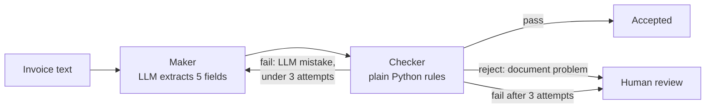

# Self-Auditing Agent

An invoice extraction agent that checks its own work.

An LLM reads a messy invoice and pulls out five fields. A second step, written in plain Python, checks every answer against the invoice text before it is accepted. If the LLM got something wrong, it gets the exact error and tries again. If the document itself is the problem (a missing invoice number, a credit note, a currency we don't accept), it stops and hands the invoice to a human instead of guessing.

Built with LangGraph, LangChain and Pydantic.

## How it works



- **Maker** (`src/nodes/maker.py`) sends the invoice to the LLM and gets back a typed `InvoiceExtraction`: vendor name, invoice number, total amount, due date and currency. The invoice goes inside `<invoice>` tags and is treated as data, not instructions, so text like "ignore your rules" inside an invoice is ignored. On a retry, the Maker sees its previous answer and the Checker's reason.
- **Checker** (`src/nodes/checker.py`) uses no LLM. It checks that every value is actually printed on the invoice, in the right place: the total on the Total / Balance Due line, the due date on the Due line, the vendor not on a Bill To line, and so on. It returns one of three results:
  - `pass`: every check passed.
  - `fail`: the LLM made a mistake it can fix, so it tries again (at most 3 attempts in total).
  - `reject`: the document itself is the problem, so it goes to a human with no retry.
- **Graph** (`src/graph.py`) wires the two together with a conditional edge, and saves every step to SQLite with a LangGraph checkpointer.

### Why `fail` and `reject` are separate

An early version treated every problem as "try again". On a euro invoice, the Checker replied "currency must be INR or USD", and on the next attempt the LLM simply changed EUR to USD. Every rule passed, and €34,926.50 became $34,926.50. The fix was to split "you made a mistake" (retry) from "this document breaks policy" (reject), and never show the LLM the list of answers that would pass.

## Results

The Checker is measured on 29 labelled invoices (`data/eval/labelled_invoices.json`), each with the correct value of all five fields. They cover Indian and European number formats, part-paid bills, credit notes, missing fields, email-style invoices and prompt injection.

| Test | Result |
| --- | --- |
| Realistic wrong answers caught (subtotal as total, invoice date as due date, customer as vendor, ...) | 230 of 231 |
| Correct answers given the right verdict | 32 of 32 |
| Live run with the real LLM (24 Oct 2026) | 29 of 29 invoices fully correct |
| pytest suite (fake LLM, no API calls) | 216 tests passing |

The one miss: in a free-text email with no "Bill To" label, a rule can't tell that a name in a sentence is the customer, not the vendor.

## Run it

Needs Python 3.10 or newer (developed on 3.14) and an API key for [Sarvam](https://www.sarvam.ai/) or [Groq](https://console.groq.com) (both work; with both set, Groq is used automatically when a Sarvam call fails).

```bash
git clone https://github.com/om-salunke-ai/Self-Auditing-Agent.git
cd Self-Auditing-Agent
python -m venv .venv
.venv\Scripts\activate          # Windows
# source .venv/bin/activate     # macOS / Linux
pip install -r requirements.txt
```

Copy `.env.example` to `.env` and add at least one key:

```
SARVAM_API_KEY=your-key
GROQ_API_KEY=your-key
```

Then:

```bash
python -m src.run_agent            # run the 3 sample invoices
python -m pytest -q                # run the tests (no API calls)
python -m src.evaluate             # score the Checker on 29 labelled invoices (free, offline)
python -m src.evaluate --live      # run the real LLM on all 29 (costs API calls)
```

Results are written to `data/audit_trail.json` (latest run) and `data/audit_history.jsonl` (every run).

## Project layout

```
src/
  config.py        LLM clients: Sarvam first, Groq as fallback
  schema.py        InvoiceExtraction, the Pydantic output model
  state.py         AgentState shared between the nodes
  nodes/maker.py   Maker: the LLM extraction step
  nodes/checker.py Checker: grounding, policy and format rules
  graph.py         LangGraph wiring and SQLite checkpoints
  run_agent.py     Batch runner for the sample invoices
  evaluate.py      Scoring on the labelled invoices
tests/             pytest suite with a fake LLM
data/mocks/        3 sample invoices
data/eval/         29 labelled invoices
```

## Limitations and next steps

- Input is plain text. Scanned PDFs would need an OCR step first.
- Rules depend on labels like "Total" or "Due Date"; free-text invoices with no labels are harder (see the one miss above).
- Rejected invoices are logged, not yet routed to a review screen. LangGraph's `interrupt()` would let a person approve and resume the same run.
- Invoices run one at a time; `abatch` would run them in parallel.
